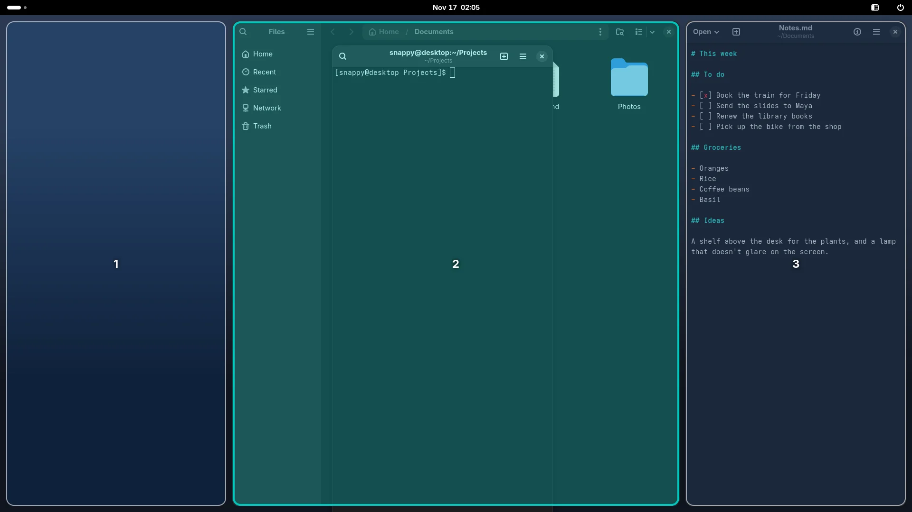
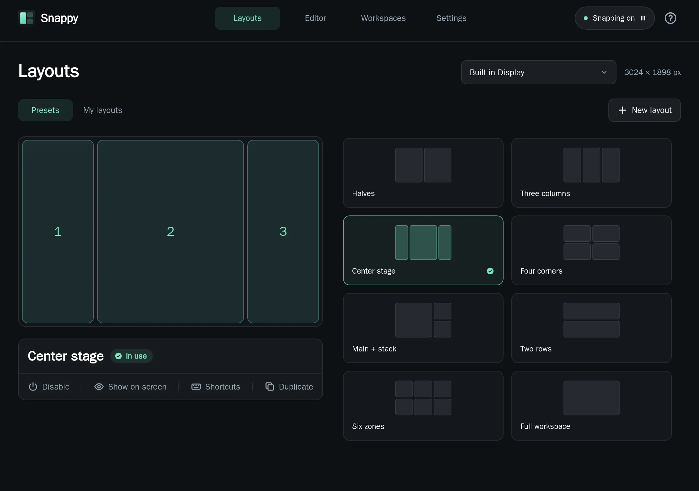

<div align="center">


# Snappy

Arrange your windows into zones, on macOS, Windows, and Linux.

<p>
  <a href="https://github.com/farhadzaidi/snappy/releases/latest">Download</a> ·
  <a href="#install">Install</a> ·
  <a href="#shortcuts">Shortcuts</a> ·
  <a href="https://github.com/farhadzaidi/snappy/issues">Report a bug</a>
</p>

<p>
  <a href="https://github.com/farhadzaidi/snappy/actions/workflows/ci.yml"></a>
  <a href="https://github.com/farhadzaidi/snappy/releases/latest"></a>
  <a href="LICENSE.md"></a>
</p>



</div>

Pick a layout for each display, then drag a window with Shift held, or press a shortcut, and it snaps into place. Snappy runs quietly in the background, with a menu bar or tray icon, and a window you open when you want to change something.

Snappy never uses the network, and never reads window titles, window contents, or what you type.

## Features

- **Layouts.** Eight ready-made layouts, or draw your own. Each display has its own.
- **Drag to snap.** Hold Shift while you drag a window, and drop it on a zone. Let go of Shift first to cancel.
- **Shortcuts.** Move windows between zones, move focus, and switch workspaces from the keyboard.
- **Swaps.** Drop a window on a taken zone to trade places, or stack on top if you prefer.
- **Workspaces.** Groups of windows, one shown at a time, each brought back exactly where it was.
- **Selection.** Select several windows to move them together.
- **Undo and redo** for window moves.

<p>
  
  
</p>

## Install

| System | |
|---|---|
| macOS 14 or later | Apple silicon and Intel |
| Windows 11 | x64 and Arm64 |
| Linux on X11 | GNOME on Xorg, KDE Plasma on X11, Xfce, Cinnamon, and other EWMH window managers |
| Linux, GNOME on Wayland | GNOME 46 to 49 |
| Linux, KDE Plasma on Wayland | Plasma 6.8 |

Other Wayland desktops aren't supported yet.

### macOS

With [Homebrew](https://brew.sh):

```sh
brew install --cask farhadzaidi/tap/snappy
```

Or download `Snappy-<version>-macos-universal.dmg` from the [latest release](https://github.com/farhadzaidi/snappy/releases/latest), open it, and drag Snappy to Applications.

Snappy is also on the Mac App Store, as **Snappy - Window Zones**. That version can't use Caps Lock as the Snappy key.

### Windows

Get **Snappy - Window Zones** from the [Microsoft Store](https://apps.microsoft.com/detail/9P50G9H8FQW8), or install it with winget:

```powershell
winget install FarhadZaidi.Snappy
```

Or download an installer from the [latest release](https://github.com/farhadzaidi/snappy/releases/latest): `Snappy-<version>-windows-x64.msi` or `Snappy-<version>-windows-x64-setup.exe`, with `arm64` in place of `x64` on Arm PCs. They aren't signed yet, so SmartScreen warns the first time: choose **More info**, then **Run anyway**.

### Linux

Download the package for your system from the [latest release](https://github.com/farhadzaidi/snappy/releases/latest), then install it:

```sh
sudo apt install ./snappy-app_<version>_amd64.deb      # Debian, Ubuntu
sudo dnf install ./snappy-app-<version>-1.x86_64.rpm   # Fedora and other RPM-based systems
```

There are `arm64` and `aarch64` packages too. On other systems, use the `.tar.gz`: copy its `usr/` folder into `~/.local/`, and install WebKitGTK 4.1 and GTK 3 if you don't have them. Snappy needs Ubuntu 22.04 or newer, or another system with glibc 2.35 or later. Start it from your apps, or run `snappy`.

To build Snappy yourself, see [CONTRIBUTING.md](CONTRIBUTING.md#building).

## Getting started

When Snappy starts, its icon appears in the menu bar or the tray, and its window opens. From the icon you can pick a layout for each display, switch workspaces, or quit. To start Snappy when you log in, turn on **Open at login** in Settings.

- **macOS:** Snappy asks for Accessibility permission. Allow it in System Settings → Privacy & Security → Accessibility, and Snappy starts working.
- **Windows:** Windows' own Snap also acts on windows dragged to screen edges. To leave drags to Snappy, turn off **Snap windows** in Settings → System → Multitasking. Windows of apps running as administrator can't be moved.
- **GNOME on Wayland:** Snappy installs a GNOME Shell extension, which GNOME loads only at login, so Snappy asks you to log out and back in once. Ubuntu's Enhanced Tiling and the Tiling Assistant extension also snap windows; Snappy says where to turn them off. With "Workspaces on primary display only" on, Snappy can't hide windows on other displays when it switches workspaces.
- **KDE Plasma on Wayland:** Snappy works straight away. If Shift-dragging also snaps windows into KWin's tiles, empty the tile layout in KWin's tile editor (Meta+T). Quick tiling at screen edges can also act where Snappy's edge zones are. If you turn on Caps Lock as the Snappy key in the session you first started Snappy in, it starts working after your next login.
- **Linux on X11:** Snappy is tested with Xfce's window manager; others may differ in window borders and moving windows between monitors. The tray icon needs a desktop that shows tray icons.

## Shortcuts

Every default shortcut is the **Snappy key** plus one other key. The Snappy key is Control+Option+Command on macOS, and Ctrl+Alt+Win (Ctrl+Alt+Super on Linux) elsewhere. You can choose other keys in Settings, and also have Caps Lock act as the Snappy key while you hold it.

| Snappy + | Does |
|---|---|
| ← → ↑ ↓ | Move the focused window to the neighboring zone |
| I J K L | Focus the next window up, left, down, or right |
| Space | Move the focused window, or the selection, into the nearest empty zone |
| Return | Select or unselect the focused window |
| `\` | Clear the selection |
| 1 to 9 | Switch to that workspace |
| `;` `'` | Previous or next workspace |
| `.` `/` | Send the focused window, or the selection, to the previous or next workspace |

Workspaces are off until you turn them on in the Workspaces tab. Every shortcut can be changed or cleared in Settings, and zones, layouts, and workspaces can have shortcuts of their own. Undo and redo have none until you record one.

## Updating

The stores update Snappy for you. Otherwise, run `brew upgrade` or `winget upgrade FarhadZaidi.Snappy`, or install the newer package over the old one. On GNOME, Snappy may ask you to log out and back in once more.

## Uninstalling

First, in Settings, turn off **Open at login**, and **Also use Caps Lock as the Snappy key** if you turned it on. Then quit Snappy from its menu, and:

- **macOS:** move Snappy from Applications to the Trash, or run `brew uninstall --cask --zap snappy`, which also removes its settings.
- **Windows:** uninstall Snappy in Settings → Apps → Installed apps, or run `winget uninstall FarhadZaidi.Snappy`.
- **Linux:** `sudo apt remove snappy-app` or `sudo dnf remove snappy-app`, or delete what you copied from the `.tar.gz`. On GNOME, also remove Snappy's extension in the Extensions app.

To remove your settings too, delete Snappy's folders:

- macOS: `~/Library/Application Support/Snappy` and `~/Library/Logs/Snappy`, or for the Mac App Store version, `~/Library/Containers/io.github.farhadzaidi.Snappy`
- Windows: `%APPDATA%\Snappy` and `%LOCALAPPDATA%\Snappy`. The Microsoft Store version's files go with it.
- Linux: `~/.config/snappy` and `~/.local/state/snappy`

## Contributing

Bug reports and ideas are welcome as [GitHub issues](https://github.com/farhadzaidi/snappy/issues). [CONTRIBUTING.md](CONTRIBUTING.md) explains how to build, test, and send a change.

## Privacy

Snappy collects nothing and never uses the network. [PRIVACY.md](PRIVACY.md) lists exactly what it keeps on your computer.

## License

Snappy's source is public under the [Functional Source License, Version 1.1, ALv2 Future License](LICENSE.md) (FSL-1.1-ALv2). You can read it, build it, change it, and share it for any purpose except offering it in a commercial product or service that competes with Snappy. Two years after each release, that release's code also becomes available under the Apache License 2.0.
