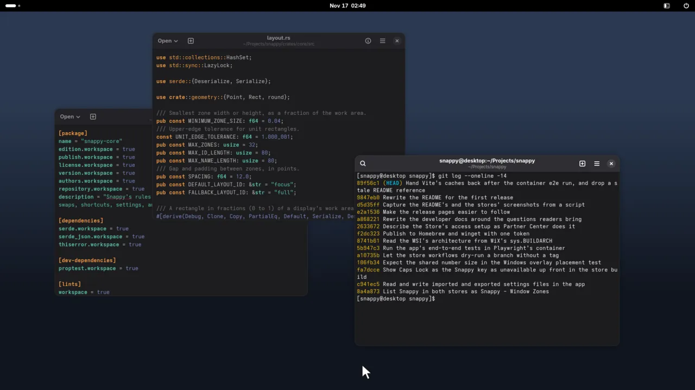
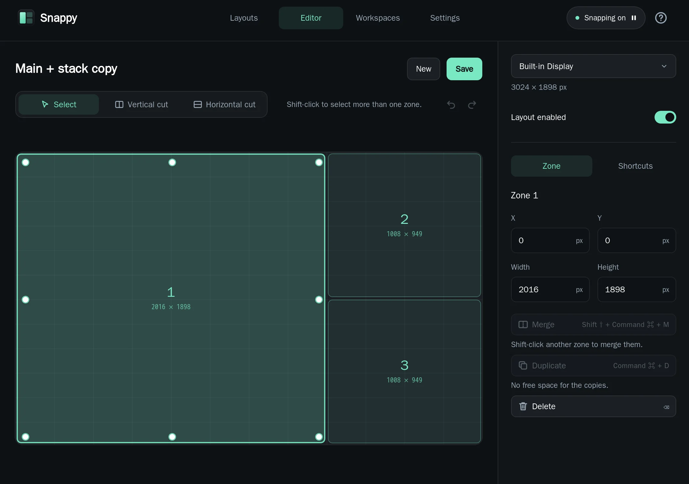
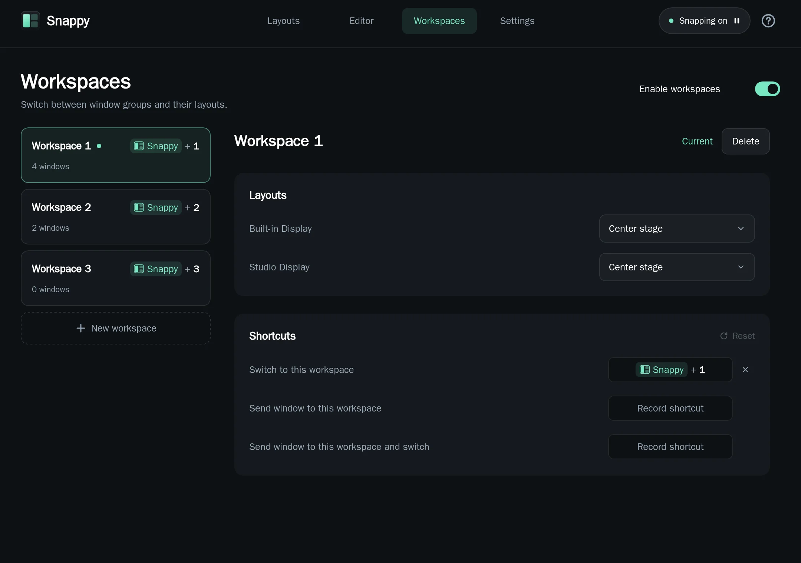
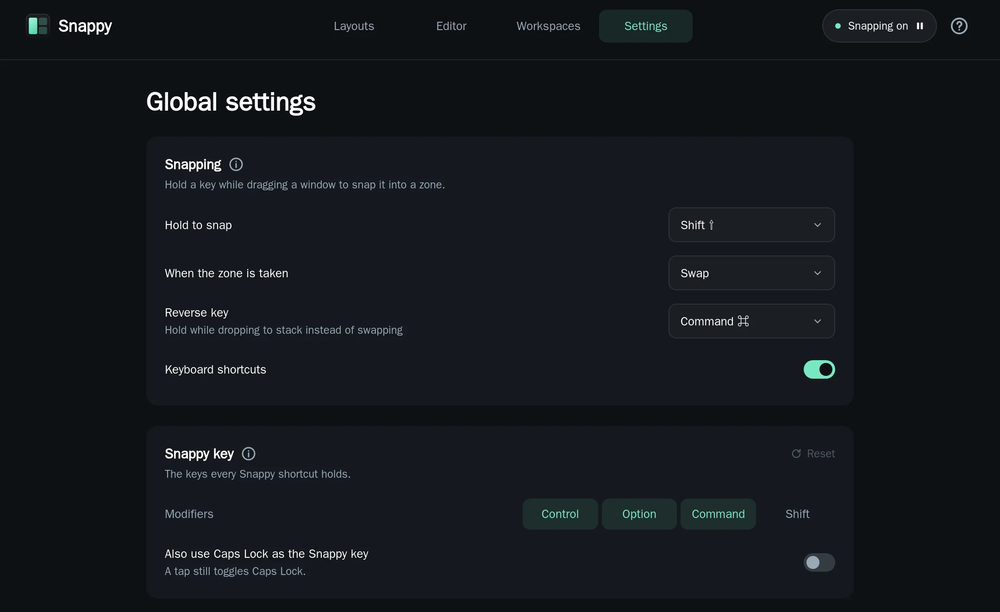

<div align="center">
<h3><br>Snappy</h3>
<p>Arrange your windows into zones, on macOS, Windows, and Linux.</p>
<p>
  <a href="#install">Install</a> ·
  <a href="#shortcuts">Shortcuts</a> ·
  <a href="docs/README.md">Docs</a> ·
  <a href="https://github.com/farhadzaidi/snappy/issues">Report a bug</a>
</p>
<p>
  <a href="https://github.com/farhadzaidi/snappy/releases/latest"></a>
  <a href="LICENSE.md"></a>
</p>
<p></p>
</div>

Snappy arranges your windows into zones. Pick a layout for each display, then drag a window with Shift held, or press a shortcut, and it snaps into place.

- **One tool everywhere.** The same app and shortcuts on macOS, Windows, and Linux, GNOME and KDE Plasma on Wayland included.
- **Easy to use.** Pick a layout, or draw your own, in a clean, simple app.
- **Yours to shape.** A layout for each display, your own zones, and your own keys and shortcuts.
- **Light and quiet.** It runs in the background, from the menu bar or tray, until you need it.

## Features

- **Layouts.** Eight ready-made layouts, or draw your own in the layout editor.
- **Drag to snap.** Hold Shift while you drag a window, and drop it on a zone. Let go of Shift first to cancel.
- **Full keyboard control.** Move windows between zones, move focus, and switch workspaces with [shortcuts](#shortcuts).
- **Send to back.** Press a shortcut to send the focused window behind the windows it covers, so they show, or hold it to peek behind and let go to put it back.
- **Workspaces.** Switch between groups of windows, each brought back exactly where it was.
- **Swaps.** Drop a window on a taken zone to trade places, or stack on top if you prefer.
- **Selection.** Select several windows to move them together.
- **Undo and redo** for window moves.

## The app

<h4 align="center">Pick a layout for each display</h4>
<p align="center">
  
</p>
<br>
<h4 align="center">Draw your own in the layout editor</h4>
<p align="center">
  
</p>
<br>
<h4 align="center">Give each workspace its own layouts</h4>
<p align="center">
  
</p>
<br>
<h4 align="center">Make it work your way in Settings</h4>
<p align="center">
  
</p>

## Install

| System | |
|---|---|
| macOS 14 or later | Apple silicon and Intel |
| Windows 11 | x64 and Arm64 |
| Linux on X11 | GNOME on Xorg, KDE Plasma on X11, Xfce, Cinnamon, and other EWMH window managers |
| Linux, GNOME on Wayland | GNOME 46 to 49 |
| Linux, KDE Plasma on Wayland | Plasma 6.8 |

Other Wayland desktops aren't supported yet.

### macOS

**With [Homebrew](https://brew.sh)**

```sh
brew install --cask farhadzaidi/tap/snappy
```

**Or download it**

1. Get `Snappy-<version>-macos-universal.dmg` from the [latest release](https://github.com/farhadzaidi/snappy/releases/latest).
2. Open it, and drag Snappy to Applications.

### Windows

**With winget**

```powershell
winget install FarhadZaidi.Snappy
```

**Or download it**

1. Get `Snappy-<version>-windows-x64.msi` or `Snappy-<version>-windows-x64-setup.exe` from the [latest release](https://github.com/farhadzaidi/snappy/releases/latest). On an Arm PC, get the `arm64` one.
2. Run it. It isn't signed yet, so SmartScreen may warn you: choose **More info**, then **Run anyway**.

**Or from the Microsoft Store:** [Snappy - Window Zones](https://apps.microsoft.com/detail/9P50G9H8FQW8)

### Linux

- Snappy needs Ubuntu 22.04 or newer, or glibc 2.35 or later on other distributions.
- Get the file for your system from the [latest release](https://github.com/farhadzaidi/snappy/releases/latest). On an Arm PC, get the one with `arm64` or `aarch64` in its name.

**Debian or Ubuntu**

```sh
sudo apt install ./snappy-app_<version>_amd64.deb
```

**Fedora and other RPM-based distributions**

```sh
sudo dnf install ./snappy-app-<version>-1.x86_64.rpm
```

**Anywhere else**

1. Install WebKitGTK 4.1 and GTK 3 with your package manager.
2. Unpack `snappy-app-<version>-linux-x86_64.tar.gz`, and copy its `usr/` folder into `~/.local/`.

**Then** start Snappy from your apps, or run `snappy`.

## Getting started

- Snappy's icon appears in the menu bar or the tray, and its window opens.
- Hold Shift while you drag a window, and drop it on a zone.
- To start Snappy when you log in, turn on **Open at login** in Settings.

Notes for your system:

<details>
<summary><b>macOS</b></summary>

- Allow Snappy in System Settings → Privacy & Security → Accessibility.
- Snappy starts working as soon as you do.
- [More about macOS](docs/platforms/macos.md#limitations)

</details>

<details>
<summary><b>Windows</b></summary>

- Turn off **Snap windows** in Settings → System → Multitasking, so Windows doesn't snap your drags too.
- Snappy can't move windows of apps running as administrator.
- [More about Windows](docs/platforms/windows.md#limitations)

</details>

<details>
<summary><b>GNOME on Wayland</b></summary>

- Log out and back in once when Snappy asks. GNOME loads Snappy's extension only at login.
- If Ubuntu's Enhanced Tiling or the Tiling Assistant extension is on, turn it off. Snappy tells you where.
- [More about GNOME](docs/platforms/gnome.md#limitations-and-settings-that-get-in-the-way)

</details>

<details>
<summary><b>KDE Plasma on Wayland</b></summary>

- Snappy works straight away.
- If Shift-dragging also snaps windows into KWin's tiles, empty the tile layout in KWin's tile editor (Meta+T).
- [More about KDE Plasma](docs/platforms/kde.md#kwin-settings-that-get-in-the-way)

</details>

<details>
<summary><b>Linux on X11</b></summary>

- Snappy works with most window managers. It's tested with Xfce's.
- The tray icon needs a desktop that shows tray icons.
- [More about X11](docs/platforms/x11.md#limitations)

</details>

## Shortcuts

Every shortcut is the Snappy key plus one more.

| | Snappy key |
|---|---|
| macOS | <kbd>Control</kbd> <kbd>Option</kbd> <kbd>Command</kbd> |
| Windows | <kbd>Ctrl</kbd> <kbd>Alt</kbd> <kbd>Win</kbd> |
| Linux | <kbd>Ctrl</kbd> <kbd>Alt</kbd> <kbd>Super</kbd> |

Or hold <kbd>Caps Lock</kbd>, once you turn that on in Settings.

| Snappy + | |
|---|---|
| <kbd>←</kbd> <kbd>→</kbd> <kbd>↑</kbd> <kbd>↓</kbd> | Move the focused window to the neighboring zone |
| <kbd>I</kbd> <kbd>J</kbd> <kbd>K</kbd> <kbd>L</kbd> | Focus the next window up, left, down, or right |
| <kbd>B</kbd> | Press to send the window to the back; hold to peek |
| <kbd>Space</kbd> | Move the focused window, or the selection, into the nearest empty zone |
| <kbd>Return</kbd> | Select or unselect the focused window |
| <kbd>&#92;</kbd> | Clear the selection |
| <kbd>1</kbd> … <kbd>9</kbd> | Switch to that workspace |
| <kbd>;</kbd> <kbd>'</kbd> | Previous or next workspace |
| <kbd>.</kbd> <kbd>/</kbd> | Send the focused window, or the selection, to the previous or next workspace |

- Workspaces are off until you turn them on in the Workspaces tab.
- Change or clear any shortcut in Settings, and give zones, layouts, workspaces, undo, and redo shortcuts of their own.

## Updating

- The Microsoft Store updates Snappy for you.
- Homebrew: `brew upgrade`
- winget: `winget upgrade FarhadZaidi.Snappy`
- Downloads: install the newer one over the old one.
- On GNOME, Snappy may ask you to log out and back in once more.

## Uninstalling

macOS and Linux:

```sh
/bin/bash -c "$(curl -fsSL https://github.com/farhadzaidi/snappy/releases/latest/download/uninstall.sh)"
```

Windows, in PowerShell:

```powershell
irm https://github.com/farhadzaidi/snappy/releases/latest/download/uninstall.ps1 | iex
```

The script:

- quits Snappy, bringing back any windows hidden in other workspaces;
- turns off **Open at login**, and gives Caps Lock back;
- removes Snappy's GNOME extension;
- deletes Snappy's settings;
- removes Snappy the way you installed it, and asks before anything that needs an administrator;
- for a copy from a store, cleans up the same way, then removes Snappy or asks you to.

To keep your settings, add `--keep-settings` on macOS and Linux:

```sh
/bin/bash -c "$(curl -fsSL https://github.com/farhadzaidi/snappy/releases/latest/download/uninstall.sh)" _ --keep-settings
```

or `-KeepSettings` on Windows:

```powershell
& ([scriptblock]::Create((irm https://github.com/farhadzaidi/snappy/releases/latest/download/uninstall.ps1))) -KeepSettings
```

## Contributing

- **Found a bug, or have an idea?** [Open an issue](https://github.com/farhadzaidi/snappy/issues).
- **Want to build Snappy yourself, or send a change?** Start with [CONTRIBUTING.md](CONTRIBUTING.md).

## Privacy

Snappy collects nothing and never uses the network. [PRIVACY.md](PRIVACY.md) lists exactly what it keeps on your computer.

## License

Snappy's source is public under the [Functional Source License, Version 1.1, ALv2 Future License](LICENSE.md) (FSL-1.1-ALv2).

- **You can** read it, build it, change it, and share it, for any purpose but one.
- **You can't** offer it in a commercial product or service that competes with Snappy.
- **Two years after each release**, that release's code is also available under the Apache License 2.0.
