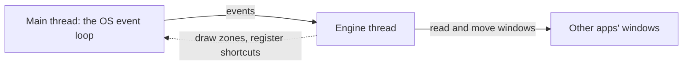
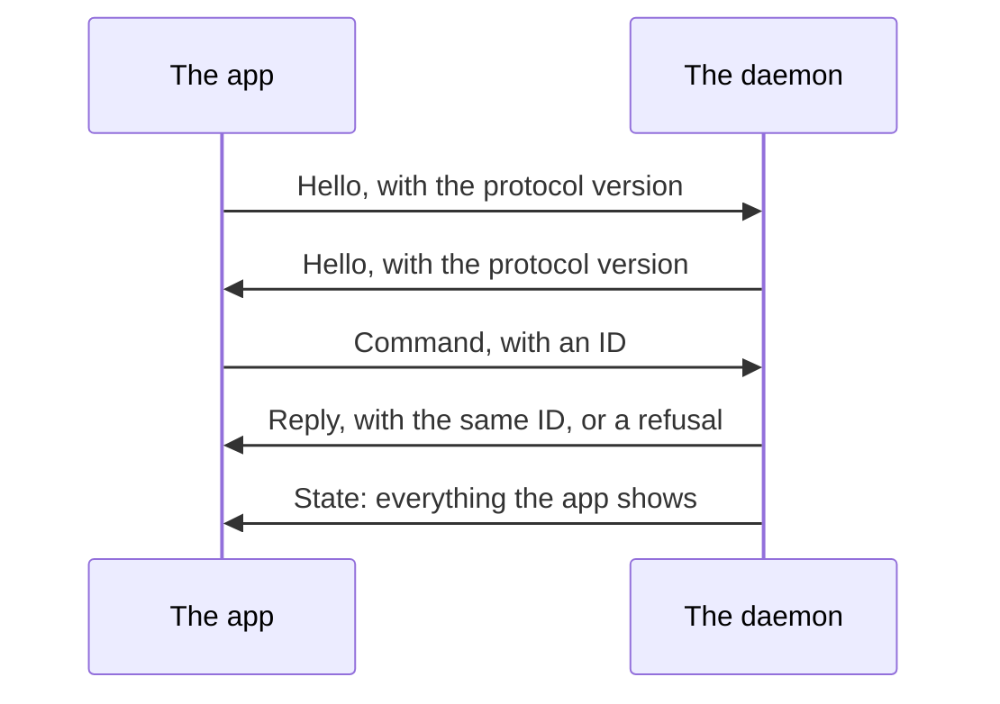

# The daemon and the app

This page is for anyone changing how Snappy starts, stops, or talks to its window. It covers the two programs' lifetimes, the threads inside the daemon, the messages between the daemon and the app, and how the app is put together.

## How the daemon starts

The daemon, `snappy`, understands these flags and two environment variables. Their names are defined in `crates/platform/src/launch.rs`, and `apps/snappy/src/arguments.rs` reads them.

- `--background` starts it quietly, as the login item does. Started any other way, as when someone opens Snappy from a launcher, it also opens Snappy's window.
- `--stop-for-restart` is for Windows only. It asks the running daemon to stop for a restart, and waits for it to exit. [Quitting, or stopping for a restart](#quitting-or-stopping-for-a-restart) explains why that's different from quitting.
- `--uninstall` removes everything Snappy added, and `--keep-settings` beside it keeps the settings file. [Uninstalling](#uninstalling) explains it.
- `SNAPPY_HOME=<folder>` keeps every file Snappy writes in that folder instead of the usual places. The tests use it to run the daemon against scratch settings.
- `SNAPPY_DEBUG=1` turns the debug log on, whatever the settings say.

Anything else on the command line is refused with a short message and exit status 2, so a mistyped flag, or one a newer script passes to an older Snappy, never starts the daemon instead. The one exception is the `-psn_…` argument older macOS adds when it launches an app.

On Linux, the daemon then picks an adapter for the session it's in: GNOME on Wayland, KDE Plasma on Wayland, or X11 for everything else. [Linux](platforms/linux.md#picking-an-adapter) explains how.

## Two threads, and why

The daemon runs on two threads.

The **main thread** belongs to the adapter. It runs the OS's event loop, because AppKit and Win32 insist on it, along with everything that has to live there: input hooks, shortcuts, the overlay, the tray. It doesn't decide anything. It turns what happens into events and passes them on.

The **engine thread** runs the engine, in a single-threaded Tokio runtime (`apps/snappy/src/runtime.rs`). It reads and moves windows through the adapter, and sends work that must happen on the main thread, such as drawing the overlay, back to it.



Neither thread waits on the other for long, so a slow app can't freeze the pointer, and the engine's state needs no locks because only one thread ever touches it.

If the engine thread ends for any reason, a panic included, the adapter's loop stops too. The daemon exits rather than holding windows and keys with nothing behind them, and its next start picks up from the saved files.

## Only one Snappy at a time

Only one daemon runs per user. Launching a second one asks the running one to open Snappy's window, and then the second one exits. Each OS does this its own way:

- **macOS** takes a lock on `daemon.lock` in Snappy's state folder. Opening Snappy.app again reaches the running daemon as a reopen.
- **Linux** takes a lock on `snappy.lock` in `$XDG_RUNTIME_DIR`. A second launch sends the running daemon `SIGUSR1`.
- **Windows** holds a named mutex. A second launch signals a named event.

The platform pages have the details.

## How the app starts

The daemon starts the app, `snappy-app`, when someone asks for Snappy's window: from the menu's **Open Snappy…**, or by launching Snappy again. It passes the app `--daemon` and connects to its standard input and output (`apps/snappy/src/app_process.rs`).

Those pipes are the only connection between the two. There's no socket to find or secure, and the app can't outlive the daemon that started it. That's also why the two programs are always installed side by side: the daemon looks for `snappy-app` next to its own executable, or, inside the macOS app, at `Contents/Helpers/Snappy App.app`.

The app quits when its window closes. If someone asks for the window while the app is already running, the daemon tells it to come forward, first switching to the workspace the window is in if that workspace isn't showing.

## What the two programs say to each other

Each message is JSON, sent as a 4-byte little-endian length and then that many bytes. A message can be at most 8 MB. The messages and their framing are defined in `crates/ipc`.



**Hello** comes first, from both sides. If the protocol versions differ, the app exits, so an app and a daemon from different builds never misread each other.

**Commands** are what people do in Snappy's window: save a layout, record a shortcut, add a workspace. Each one gets a **reply** with the same ID. When the daemon says no, the reply carries a short message for the user. If the problem is a clash with one of Snappy's own shortcuts, it also names that shortcut, so the app can point at it.

**State** follows every command. It's the whole picture, not a change, so there's no partial update for the app to get wrong.

Three other messages go from the daemon to the app. One answers whether a chord is free to use as a shortcut. One carries the settings as text for exporting. And one asks the app to bring its window forward.

### Why the app opens import and export files

When someone imports or exports settings, the app shows the file picker, reads or writes the chosen file, and sends the daemon only the text. The daemon still checks that text and refuses anything that isn't valid settings.

It works this way because of the Mac App Store's sandbox, which grants a picked file only to the process that showed the picker. Doing it the same way everywhere keeps one code path.

## Inside the app

The app is two layers.

**A Rust shell**, in `apps/app/src-tauri`, built with Tauri. It passes messages between the pipes and the web UI, adds the Edit menu that text fields on macOS need for copy and paste, reports which display the window is on, and reads and writes import and export files (`src/settings_file.rs`). Its content security policy allows only bundled files, and its one plugin is the file dialog.

**A React UI**, in `apps/app/ui/src`. It has four pages, Layouts, Editor, Workspaces, and Settings, each in a folder of its own. `state/daemonClient.ts` sends commands and turns each new state into what the pages draw.

### Core, as WebAssembly

The UI never works out a rule itself. Where a zone lands, what an editor gesture does, whether two shortcuts clash, what a shortcut is called: it asks core, compiled to WebAssembly by `crates/wasm` and loaded by `core/snappyCore.ts`.

That's why a zone drawn in the editor lands exactly where the daemon puts the window, and why a clash the shortcut recorder reports is the one the daemon would.

### The layout editor

Every editing step is a rule in `crates/core/src/editor/` that takes zones and gives back zones: moving, resizing, drawing, cutting, merging, pasting, snapping to guides, and repairing overlaps. A property test checks that no sequence of steps leaves zones overlapping, too small, or more than 32 of them.

The UI keeps the draft, the selection, the clipboard, and undo (`editor/draft.ts` and `editor/editorStore.ts`), and sends the finished layout when it's saved.

### The fake daemon

`apps/app/ui/src/bridge/fake/` stands in for the real daemon during development and in the UI's tests. It speaks the same messages and applies commands with the real core rules, so the UI behaves as it would against the real thing. [CONTRIBUTING.md](../CONTRIBUTING.md#working-on-the-app-in-a-browser) shows how to use it.

## Adding a command

1. Add a variant to `Command` in `crates/ipc/src/command.rs`.
2. Handle it in `crates/engine/src/commands.rs`. If it changes settings, write the change itself as a rule in core's `settings` module, so the fake daemon can run it too.
3. Send it from the UI, and teach the fake daemon in `apps/app/ui/src/bridge/fake/` to apply it.

## Keeping Rust and TypeScript in step

Some values exist on both sides, such as the protocol version, operation and event names, and error codes. Each is checked by a Rust test that reads the TypeScript source. For example, a test in `crates/ipc/src/messages.rs` checks that the fake daemon speaks the same protocol version as the real one.

## Quitting, or stopping for a restart

The daemon can stop in two ways, and the difference is what happens to windows hidden in other workspaces.

**Quitting** brings every hidden window back on screen first. The menu's **Quit** does this. So do `SIGTERM`, `SIGINT`, and `SIGHUP` on macOS and Linux, a quit Apple Event on macOS (logging out sends one, and so do scripts), and on Windows a close request, the session ending, or Ctrl+C in a console.

**Stopping for a restart** leaves every window where it is. `SIGUSR2` does this on macOS and Linux, and `snappy --stop-for-restart` on Windows, which has no such signal. The next start puts each window back in its workspace without moving it.

A crash leaves things as stopping for a restart does. [Restarts](features.md#after-a-restart-or-a-crash) explains how windows are recognized again.

## Uninstalling

`snappy --uninstall` undoes everything Snappy added to the system and deletes its files, leaving only the program for whatever installed it to remove (`apps/snappy/src/uninstall/`). The uninstall scripts in `tools/uninstall/`, published with each release, run it first. It works through the same code that makes each change, so the scripts don't repeat any of it.

1. **It quits the running daemon** as Quit does, so hidden windows come back and Caps Lock is given back, and waits up to 30 seconds. On macOS and Linux it sends `SIGTERM` to the process ID in the daemon's lock file; on Windows it sends the daemon's hidden window a close request and waits on its mutex. If the daemon doesn't quit, it stops there.
2. **When nothing was running** but a run that didn't quit left windows hidden or Caps Lock changed, as a crash does, it starts Snappy once, in the same process, without opening its window. Starting picks up what that run left. As soon as Snappy controls the desktop, or after 15 seconds, it quits, which brings the windows back and gives Caps Lock back (`Mode::Settle` in `apps/snappy/src/runtime.rs`).
3. **Each adapter removes what it added** outside Snappy's folders, in its `uninstall` module: Open at login everywhere, and on Linux the app icon, the GNOME extension, Snappy's XKB option, KDE's keyboard settings and its applications entry, and what KDE's shortcut service keeps. Linux runs every desktop's part, since Snappy may have run on more than one.
4. **The folders go**: Snappy's settings, state, and logs folders, the web view's data that Tauri keeps for the app, and on macOS what the system keeps for it in `~/Library`, the same as the Homebrew cask's `--zap` list. With `SNAPPY_HOME` set, or in the Microsoft Store package, only Snappy's own entries in that folder go. `--keep-settings` keeps the settings file.

It says what it did, one line at a time, and exits with status 1 if anything is left. On Windows the daemon has no console of its own, so it attaches to the terminal it was run from.

### Swapping in your own build

Installing your own build to use day to day is fine. To replace a running Snappy without every hidden window coming back, stop it for a restart first, then start the new one.

These commands assume a release build (`cargo build --release -p snappy -p snappy-app`), installed where the README puts it.

On macOS:

```sh
pkill -USR2 -x snappy; while pgrep -x snappy >/dev/null; do sleep 0.2; done
ditto dist/Snappy.app /Applications/Snappy.app
open -g /Applications/Snappy.app --args --background
```

On Linux:

```sh
pkill -USR2 -x snappy; while pgrep -x snappy >/dev/null; do sleep 0.2; done
install -Dm755 target/release/snappy target/release/snappy-app -t ~/.local/bin/
~/.local/bin/snappy --background
```

On Windows, in PowerShell:

```powershell
$dest = "$env:LOCALAPPDATA\Programs\Snappy"
Start-Process -Wait "$dest\snappy.exe" -ArgumentList "--stop-for-restart"
Copy-Item target\release\snappy.exe, target\release\snappy-app.exe $dest
& "$dest\snappy.exe" --background
```

## The macOS app

`tools/macos/bundle.sh` builds `dist/Snappy.app`. Inside it:

- the daemon is `Contents/MacOS/snappy`, described by `packaging/macos/Snappy.plist`;
- the app is a helper app, `Contents/Helpers/Snappy App.app`, described by `packaging/macos/SnappyApp.plist`;
- the login item is a launch agent, `Contents/Library/LaunchAgents/io.github.farhadzaidi.Snappy.Agent.plist`, which runs the daemon with `--background`.

Neither program shows a Dock icon or appears in Command-Tab. macOS ties the Accessibility permission to the app's code signature, which is why [CONTRIBUTING.md](../CONTRIBUTING.md#on-macos) asks you to create a local signing identity.
