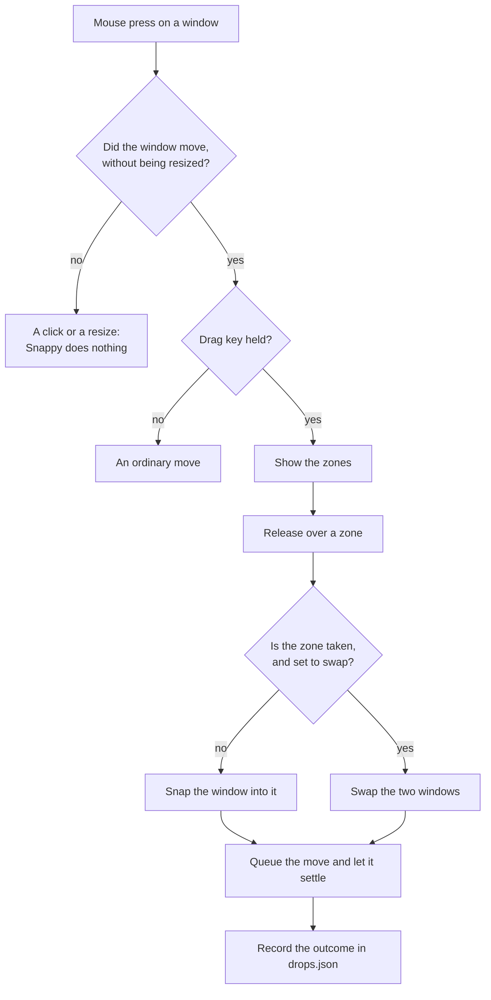

# How the features work

This page follows each of Snappy's features through the code, from the adapter through the engine to the window that moves. Read it when you're changing a feature, or tracking down why one didn't do what you expected.

- [How a drag becomes a snap](#how-a-drag-becomes-a-snap)
- [How a shortcut moves a window](#how-a-shortcut-moves-a-window)
- [Focus, selected windows, and outlines](#focus-selected-windows-and-outlines)
- [Sending a window to the back](#sending-a-window-to-the-back)
- [How workspaces hide and bring back windows](#how-workspaces-hide-and-bring-back-windows)
- [The Snappy key](#the-snappy-key)
- [Caps Lock as the Snappy key](#caps-lock-as-the-snappy-key)

## How a drag becomes a snap

A drag starts as an ordinary window move. Snappy only steps in when the window really moves and the drag key, Shift by default, is held.

Step by step, in `crates/engine/src/drag.rs`:

1. **The press.** The adapter reports a mouse press. If Snappy is live, the engine cancels any move still in progress, asks the adapter which window is under the pointer, and notes its frame. Then it asks the adapter to start reporting pointer moves and modifier keys. It doesn't watch them at any other time.
2. **The move.** On each pointer move or modifier change, the engine reads the window's frame again. Core's drag rule (`DragIntent`, in `placement/drag.rs`) decides whether this is a real move. The window has to travel a little first, and if its size changes while the pointer is outside the title bar, it's a resize, and Snappy stays out of it until the next press.
3. **The zones.** While the drag key is held and the window has moved, the engine finds the layout for the display under the pointer and the zone under the pointer, and asks the adapter to draw them.
4. **The drop.** On release, the engine checks the drag and the drag key once more and finds the zone. A drop on an empty zone is a snap. A drop on a taken zone does what the setting **When the zone is taken** says: stack the window on top, which is also a snap, or swap the two windows. Holding the swap key as well flips that choice for this one drop, and the zone's caption says "Swap" or "Stack" while you hover.

Snaps and swaps both go through the [move queue](engine.md#every-move-waits-in-one-queue). How each drop ended goes into `drops.json`, and into the debug log when it's on ([Files and diagnostics](files-and-diagnostics.md)).

## How a shortcut moves a window

### Registering

Shortcuts are registered with the OS ahead of time, not looked up on each key press. Whenever the settings, the displays, or whether Snappy is live change, the engine asks core which shortcuts the current state needs (`desired_hotkeys`, in `shortcuts/hotkeys.rs`). If that set differs from what's registered, it registers the new set.

Each shortcut goes to the adapter as a concrete key and modifiers, with the Snappy key already expanded. Adapters never know the Snappy key exists ([The Snappy key](#the-snappy-key)).

### Pressing

The adapter reports which shortcut was pressed, and the engine looks up what it does (`crates/engine/src/actions.rs`). Shortcuts do nothing while the user is recording a new shortcut in Snappy's window.

### What each kind does

**Zone shortcuts** send the focused window to a numbered zone. **Arrow shortcuts** send it to the neighboring zone in that direction (`placement/navigate.rs`). Either way, the move is a snap or a swap, as **When the zone is taken** says, and goes through the move queue.

Arrow presses that arrive while the last move is still settling continue from where that move was headed. So three quick presses move a window three zones, even in a slow app.

The **nearest empty zone** shortcut picks the closest free zone (`placement/empty_zone.rs`). With several windows selected, it places all of them at once, pairing windows with zones so they travel the least in total, as one undo step.

## Focus, selected windows, and outlines

**Focus shortcuts** move focus to the next window in a direction (`crates/engine/src/focus.rs`, with the rule in `placement/focus.rs`). When any zone holds a window, they move between zones. Otherwise they go by window centers. The newly focused window gets a brief outline.

**Selection shortcuts** keep a list of windows, in the order they were picked (`crates/engine/src/selection.rs`). Sending windows to another workspace, and switching workspaces, take the selected windows along. The list lives only in memory.

**Outlines** around selected and just-focused windows are drawn on a layer of their own, apart from the zones (`crates/engine/src/marks.rs`). They're redrawn only on displays where something changed.

## Sending a window to the back

Windows end up stacked: several in one zone, or one floating over another. One shortcut, Snappy + B by default, sends the focused window to the back as it's pressed, so the windows it covers show without anything moving. Held, it shows what's behind the window for as long as it's held, a peek, and letting go puts the window back.

### A press or a hold

It's the one shortcut whose release matters, so it's registered asking the adapter to report its release too (`HotKeyAction::reports_release`, in `shortcuts/hotkeys.rs`). Each desktop learns of a release its own way; [Adapters](platforms/adapters.md#how-the-desktops-compare) compares them. What the adapters make of it is the same everywhere. macOS, Windows, X11, and KDE keep that bookkeeping in one shared piece, `HeldShortcuts` in `crates/platform`, and GNOME's extension, which hears the keys itself, follows the same rules:

- One press and one release each time the shortcut goes down, never a key repeating. KDE reports a held key's repeats as presses, so there a press counts as a repeat only within a second of the last; elsewhere the OS never repeats a held shortcut, or the adapter knows the key is still down.
- A press while the shortcut still counts as down, its release unseen, is reported alone, as a new press: reported let go first, the press before would be timed as a hold. On X11 the grab always sees the key come up, so there a press while it's down is only ever the key repeating.
- Registering the shortcuts again forgets one held, and its release is never reported. The engine leaves the window at the back then.

The window goes to the back as the shortcut goes down, so the windows behind show at once. Core tells a quick press from a hold as it's let go (`send_to_back/press.rs`): down a fifth of a second or longer, it was a hold, and the window goes back where it was ([Putting it back](#putting-it-back)). A hand's quick press lasts well under a tenth. The engine times both by when each event reached the daemon, which takes events in on a thread of its own (`Input::platform`), so a quick press let go while a slow call held the engine up is still quick (`crates/engine/src/send_to_back/press.rs`). A press whose release went unseen counts as quick, since how long it was held is unknown.

### Sending

A press sends the focused window behind every window it covers (`send_to_back/plan.rs`): the windows visible on the active workspace that are behind it and overlap it, front to back as the adapter lists them. Windows that only touch, as neighbors in adjacent zones may once their frames are rounded, don't count. A focused window the adapter doesn't list, so that what's behind it is unknown, stays where it is.

It's the only window that moves: every other window stays in front of or behind each window it overlaps, as it was. Focus goes to a window over where it was, and since every platform raises the window it focuses, core picks one that focusing won't bring in front of a window it was behind (`SendToBack::focus`):

- A window floating over three zones' windows goes behind all three, and the frontmost of them takes focus.
- Pressed again, that window goes behind the floating one. The floating window is the only window over its frame now, but the other two zones' windows overlap it from in front, so the front of those two takes focus, and the floating window stays behind them.

So press after press goes through the windows stacked there. Platforms report the focus a press gives a moment later. So the engine remembers the last send, and a press while focus is still reported on the window sent back, which is still behind the window it focused, sends that one (`Sent::next_target`). Once focus is reported to change, wherever to, the next press sends the focused window.

A send changes the stack, so it waits in the [move queue](engine.md#every-move-waits-in-one-queue) like any move (`crates/engine/src/send_to_back/sends.rs`). Sends queue behind one another there rather than cancel, so quick presses each count; any other operation still cancels the sends waiting, while the send under way finishes without waiting. The engine does it one of two ways, as the platform's capabilities say how it restacks another app's window (`Restacking`):

- **Lowered** behind every other window, then the window core picks is focused, wherever the platform can lower another app's window: on Windows and Linux (`WindowSystem::lower`).
- **Raised over**, on macOS, where Accessibility can raise another app's window but not lower one. Core picks the windows to raise (`send_to_back/raised_over.rs`) and the steps that raise them (`send_to_back/raises.rs`), and the engine awaits a step in the platform's window list where core says, without holding up the engine (`crates/engine/src/send_to_back/raising.rs`). [macOS](platforms/macos.md#sending-a-window-to-the-back) has how it looks.

### Putting it back

A press held a fifth of a second or longer has sent the window to the back as any press does, and it stays there while the shortcut is held. Letting go puts it back where it was, focused (`crates/engine/src/send_to_back/put_back.rs`): focusing it brings it to the front, where it was, as a focused window is, and where a window in front of it overlapped it, it goes back under the window just in front of it on the platforms that can restack a window under another, Windows and X11 (`Restacking::Lower { stack_below: true }`, `WindowSystem::stack_below`). With none overlapping it, the front is where it was among the windows it overlaps. The windows raised over it on macOS stay where they are, behind it as they were. Nothing moves, so nothing needs to come back after a crash or a quit.

Focus is reported on the window focused while it was held for a moment after, so the engine remembers the put-back as a send of that window, and a press meanwhile sends the window put back (`Sent::put_back`). Putting it back waits its turn in the send queue, after its own send. Anything else that acts on the windows meanwhile leaves the window at the back instead: any other operation, a click, which may start a drag and gives focus to what it presses, another shortcut, changes to the displays, the desktop, or Snappy's control, and the shortcuts registered again, after which putting it back would pull the user away.

The debug log records each send as `sentToBack`, with the window sent back, the window focused, how many windows it went behind, how many raises it took on macOS and whether the window list showed their last order (`reached`), and how long the send took, or an error. It records each window put back as `putBack`, with the window it went back under and, where the platform can restack it there, whether it did.

## How workspaces hide and bring back windows

A workspace is a group of windows. One group shows at a time. Switching hides the others, which the code calls **parking**, and brings the chosen group back exactly where it was.

### Switching without losing a window

Core's workspace session (`workspace/session.rs`) records each window's workspace, its frame, and where it waits while hidden. It makes every switch all or nothing:

1. Before hiding anything, it writes down which windows are about to be hidden, in a journal file. If Snappy crashes halfway, the next start knows where they went.
2. It brings the incoming windows back before hiding the outgoing ones, so the screen is never empty in the middle of a switch.
3. It checks every move. If one is refused, it reverses the moves already made. A window that closes during the switch just leaves the workspace.

Around that, the engine (`crates/engine/src/workspaces/switching.rs`) refuses a switch while workspaces are paused or the target is already showing, and holds it while displays are changing. Then it adds the focused app's windows to the current workspace, takes selected windows along, focuses the window that last had focus in the target workspace, saves, and updates shortcuts and overlays.

### Where hidden windows go

Each OS needs a different hiding place:

- **macOS** pulls windows that are fully off screen back on. So Snappy parks them at an exposed bottom corner, with a sliver still showing.
- **Windows** leaves off-screen windows alone, so Snappy parks them entirely off screen.
- **Linux** desktops don't reliably let a window sit off screen. So Snappy adds a desktop of its own, a workspace on GNOME, and moves windows there with their frames untouched.

The platform pages have the details.

### Windows that come back by themselves

Sometimes an app or the OS brings a hidden window back on screen. The engine (`workspaces/containment.rs`) hides it again at once, tries once more a second later, and only then tells the user, naming the workspace the window belongs to.

### When displays change

Displays tend to change in bursts, as when a laptop wakes up and finds its external monitor. The engine (`workspaces/events.rs`) waits until 350 ms pass without a change. Then it places every window for the displays as they are now, in one go. If that fails, it tries again after 750 ms, and after that hides the other workspaces' windows one at a time.

### Other desktops, and losing control

Workspaces belong to the OS's own desktop they started on, such as a macOS Space or a Windows virtual desktop. On any other, they pause. Each adapter tells the engine which desktop is showing.

When Snappy stops being live, workspaces are suspended without moving anything, and resume when it's live again.

### After a restart or a crash

Quitting brings every hidden window back. Stopping for a restart, a crash, or a panic leaves the journal and the list of which window belongs where as they are. The next start puts each window back in its workspace without moving it (`workspaces/recovery.rs`).

To recognize a window across a restart, Snappy combines three things: the process ID, the time that process started, and an ID for the window from the adapter. The start time is what keeps a reused process ID from matching the wrong window. Core's `workspace/relaunch.rs` decides what becomes of each window in the journal.

### Native tabs on macOS

On macOS, each native tab is a window of its own. Workspaces treat a group of tabs as one window: they act on the tab that's showing and carry the hidden ones along. Before every workspace switch, and whenever focus changes in an app, the engine asks the adapter again which windows are tabs, so a tab that comes out of its group is on its own from then on. [macOS](platforms/macos.md#native-tabs) explains how Snappy learns which tabs belong together, and why it would rather miss a tab than take a window for one.

## The Snappy key

The Snappy key is one key that stands for two or more modifiers the user chooses. By default it's Control, Option, and Command on macOS, and Ctrl, Alt, and Win or Super elsewhere. Every default shortcut is the Snappy key plus one other key.

### Stored as a name, not as modifiers

A shortcut stores "the Snappy key" by name, rather than the modifiers it stands for at the moment. When someone records a shortcut, the recorder decides once whether the modifiers they held were the Snappy key or ordinary modifiers.

The name is turned into real modifiers in only one place (`KeyChord::combo`, in `keys/chord.rs`). So clash checks, chords the OS keeps, checks with the OS, and registration all compare real key combinations, and labels in Snappy's window can always say "Snappy".

### Changing it

Changing the Snappy key changes most shortcuts at once, so the whole change is checked before anything is saved:

1. every shortcut, against every other, with the new modifiers;
2. each shortcut whose keys changed, against the OS, to see whether another app holds it (`availability_probes`, in `shortcuts/probes.rs`).

If both pass, the shortcuts are registered again straight away.

## Caps Lock as the Snappy key

Users can choose to have Caps Lock stand for the Snappy key while it's held. Tapping it still toggles Caps Lock. The work is split three ways.

**The adapter makes Caps Lock act as the Snappy key**, with whatever its OS offers. It refuses if something else already remaps Caps Lock. While the setting is on, it reports when Caps Lock goes down, when another key or a click happens while it's down, and when it comes up. It never says which key was pressed. The platform pages explain how each OS does it.

**Core decides what a press was** (`keys/caps_lock.rs`). If nothing else was used and the key came up quickly, it was a tap, and the engine toggles Caps Lock. Anything else was a hold.

**The engine keeps it all in step** (`crates/engine/src/caps_lock.rs`) with the setting, the permission, whether Snappy is live, and the Snappy key itself.

### Undoing it after a crash

On some systems, holding Caps Lock as the Snappy key changes the system's keyboard settings. While such a change is in place, the engine keeps what's needed to undo it in `caps-lock.json`. If Snappy crashes, the next start undoes the change before doing anything else.

If the system's keyboard settings change while Snappy is running, the adapter reports Caps Lock lost. The engine then sets it up again on top of the new settings, unless those now remap Caps Lock themselves.

### Builds where it can't work

The Mac App Store build can't remap keys at all. Its adapter says so up front, with a sentence for the user.

The engine passes that sentence to the app, which shows the setting turned off and disabled, with the sentence underneath. The engine also treats the setting as off, even if the settings file says on, as one imported from another build might. It never asks the adapter, so nothing about Caps Lock appears when Snappy starts, and turning the setting on is refused with the same sentence.
