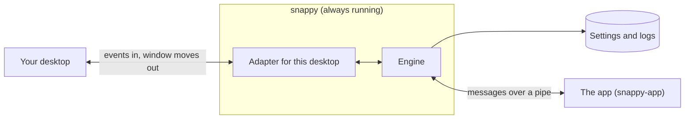
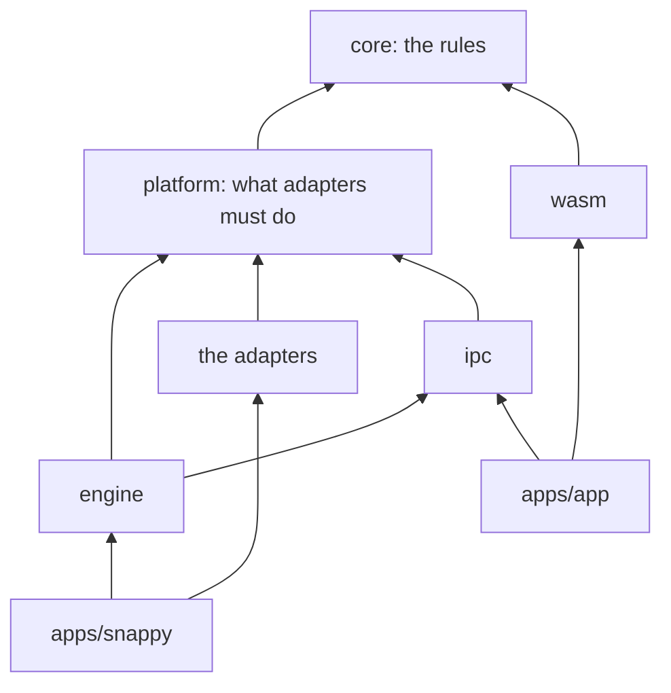

# How Snappy is built

Start here if you want to change Snappy's code. This page explains the two programs Snappy is made of, who decides what, and which folder to open for the change you have in mind.

## What runs on your computer

Snappy is two programs.

The **daemon**, `snappy`, runs in the background all the time. It watches for drags and shortcuts, moves windows, draws the zones you see while dragging, and owns the menu bar or tray icon.

The **app**, `snappy-app`, is Snappy's window, where people pick layouts, edit zones, manage workspaces, and change settings. The daemon starts it when someone asks for it, and it quits when its window closes. It never touches other apps' windows: it sends the daemon requests and shows what the daemon reports back.

[The daemon and the app](daemon-and-app.md) covers how the two start, stop, and talk.

## Follow one drag through the code

With the default settings, you hold Shift and drag a window by its title bar. The adapter for your desktop sees the press and the pointer moving, and passes each one on to the engine as a plain event.

The engine asks core whether this is really a move, not a click, and which zone is under the pointer. Then it asks the adapter to draw the zones. When you let go, the engine puts the move in its queue, and the adapter carries it out.

That's the whole split: core decides, the engine sequences, and the adapter does. [How the features work](features.md#how-a-drag-becomes-a-snap) follows the same drag in more detail.

## Who decides what

**Core** holds every rule. Where a zone sits, whether a drop snaps or swaps, which window focus moves to, whether a setting is valid: all of that is core. It never touches the OS, starts a thread, or reads a clock, so a rule behaves the same on every machine and in every test.

**The engine** holds what's true right now: the settings, the displays, the drag in progress, the workspaces. It decides when things happen and in what order. Every window move goes through its one queue, and it's the only code that writes Snappy's files.

**An adapter** is the only code that talks to an OS. It reports what happened, answers questions about windows, and carries out moves. It never chooses between behaviors: when an adapter would have to decide something, that decision belongs in core or the engine.

**The app** shows what the daemon sends and sends back what people do. When it needs a rule, such as where a zone drawn in the editor lands, it asks core, compiled to WebAssembly. So the app and the daemon can never disagree.

## Where the code lives

The Rust code is split into crates so each part can only reach what it should.

**The rules.** `crates/core` is core. `crates/wasm` packages it for the app.

**The engine.** `crates/engine`.

**The adapters.** One crate per desktop: `crates/macos`, `crates/windows`, `crates/x11`, `crates/gnome`, and `crates/kwin` for KDE Plasma. Each one compiles to nothing on other systems. Code the three Linux adapters share is in `crates/linux`. GNOME and KDE also need code that runs inside the desktop itself: a GNOME Shell extension in `crates/gnome/extension` and a KWin script in `crates/kwin/script`.

**The contracts.** `crates/platform` says what every adapter must be able to do, as a set of Rust traits, and which events adapters report. `crates/ipc` says what the daemon and the app can say to each other.

**Test support.** `crates/fake` is a pretend desktop in memory, for testing the engine. `crates/live` drives the real daemon against real windows in a sandbox. Neither ships.

**The programs.** `apps/snappy` is the daemon's entry point: it picks the adapter and runs the engine. `apps/app` is the app, a small Rust shell (`src-tauri`) around a React UI (`ui`).

Arrows point from a crate to the ones it uses. Core sits at the bottom, so it can't reach the engine. OS libraries appear only in the adapters, `crates/linux`, and the live tests, so the engine can't call an OS directly. The compiler keeps the layers honest, and core and the engine build and test on any machine.

Outside the crates:

- `tools/` holds the scripts for checking, building the macOS app, regenerating the icon, releasing, and the test sandboxes (`tools/live/`).
- `packaging/` holds what the installers and stores need.
- `assets/icon/` holds the icon's source files and what's generated from them.

## Where does my change go?

- **A rule**, such as how zones are hit-tested or when a settings change is invalid: `crates/core`, with unit tests beside it. [Where to find a rule](engine.md#where-to-find-a-rule) lists the modules.
- **When something happens, or what state changes because of it**: `crates/engine`.
- **How one OS does something**: that OS's adapter, or `crates/linux` if more than one Linux adapter needs it.
- **Something new that every adapter must be able to do**: a trait method in `crates/platform`, implemented by each adapter and by `crates/fake`.
- **Something new the app can ask for**: a new command. [Adding a command](daemon-and-app.md#adding-a-command) has the steps.
- **A rule the app needs too**: `crates/core`, exported through `crates/wasm`.
- **A page of the app**: its folder under `apps/app/ui/src`, such as `layouts`, `editor`, `workspaces`, or `settings`.

## Rules the whole codebase keeps

These shape almost every file. [AGENTS.md](../AGENTS.md) has the full list.

**Privacy.** Snappy makes no network connections of any kind. It never reads, logs, or stores window titles, URLs, window contents, or keystrokes. A test, `apps/snappy/tests/privacy.rs`, fails the build if the daemon links a network client.

**Quiet when idle.** Nothing polls or wakes up while nobody's using Snappy. The keyboard is watched only during a drag or a window move, and Caps Lock alone when it stands in for the Snappy key.

**Never freeze the desktop.** No OS call that can block runs on a thread that handles input or drawing. A hung app can slow down a move, but it can't freeze the pointer or the overlay.

**No test code in what ships.** Tests use fakes. What tests need to read from an adapter lives in that adapter's `reference` module, compiled only with its `reference` feature.
